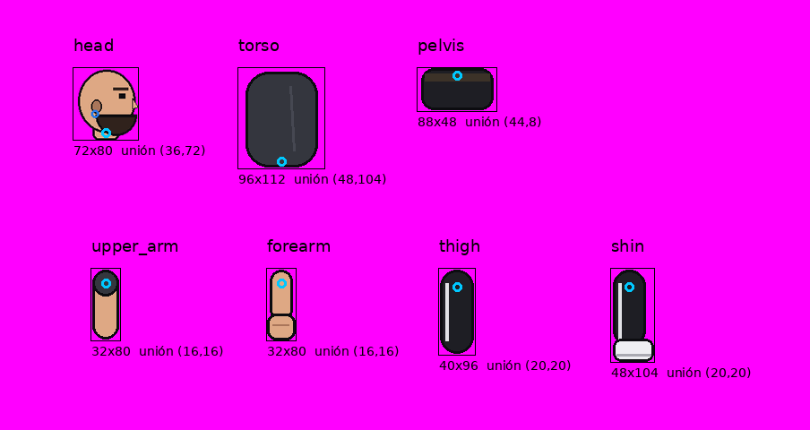

# Especificación de skins (personajes por piezas)

Un personaje se dibuja con **4 piezas**. Cuerpo, brazo y pierna son **mallas deformables**: el juego las dobla en la cintura, el codo y la rodilla, así la imagen se curva entera en vez de partirse en dos. La cabeza es rígida y gira en el cuello.



En la plantilla, el círculo **celeste** es el punto de unión de cada pieza y el **naranja** la articulación donde se dobla (codo y rodilla; el cuerpo se dobla en la misma cintura).

## Archivos de una skin

| Archivo                  | Obligatorio | Para qué                                                                 |
|--------------------------|-------------|--------------------------------------------------------------------------|
| `<pieza>.png`            | sí          | La pieza mirando a la **derecha**: muestra el **lado izquierdo** del personaje. |
| `<pieza>_left.png`       | no          | La pieza mirando a la **izquierda**, dibujada así: muestra el **lado derecho**. Si no existe, se voltea la normal. |
| `<pieza>_back.png`       | no          | Brazo o pierna de atrás con imagen propia, mirando a la derecha (rara vez hace falta). |
| `<pieza>_back_left.png`  | no          | Lo mismo, mirando a la izquierda.                                        |
| `skin.json`              | no          | Punto de unión y escala de cada imagen (lo genera el importador).        |

Las piezas son `head`, `body`, `arm` y `leg`.

### Qué imagen se usa en cada caso

| Mirando a | Brazo/pierna de adelante        | Brazo/pierna de atrás (oscurecido)            |
|-----------|---------------------------------|-----------------------------------------------|
| Derecha   | `<pieza>` (lado izquierdo)      | `_back` → `<pieza>_left` (lado derecho) → `<pieza>` |
| Izquierda | `<pieza>_left` → `<pieza>`      | `_back_left` → `<pieza>` (lado izquierdo)     |

Así, un detalle de un solo lado queda siempre en su lugar. Por ejemplo, una rodillera en la pierna izquierda va en `leg.png`: se ve adelante al mirar a la derecha y atrás al mirar a la izquierda.

## Reglas de dibujo

- **Formato:** PNG con fondo transparente. Máximo 1024 px por lado.
- **Orientación:** de perfil. Brazo y pierna **rectos, colgando hacia abajo, sin doblar**.
- **Ancho parejo en codo y rodilla:** es la zona que se estira y comprime al doblarse.
- **Extremos de arriba redondeados** en brazo y pierna: quedan escondidos detrás del cuerpo al girar.
- **Sin sombras proyectadas ni brillos externos.**

## Tamaños y puntos de unión (personaje mediano)

| Pieza  | Qué es                                   | Juego (px) | Arte recomendado (px) | Unión (arte)        | Se dobla en            |
|--------|------------------------------------------|-----------:|----------------------:|---------------------|------------------------|
| `head` | Cabeza de perfil con cuello              | 18 × 20    | 72 × 80               | (36, 72) cuello     | —                      |
| `body` | Torso y cadera en una pieza              | 24 × 36    | 96 × 144              | (48, 104) cintura   | la cintura             |
| `arm`  | Brazo completo, del hombro al puño       | 8 × 32     | 32 × 128              | (16, 16) hombro     | codo, 12 px bajo la unión |
| `leg`  | Pierna completa, de la cadera a la zapatilla | 12 × 40 | 48 × 160            | (20, 20) cadera     | rodilla, 14 px bajo la unión |

Las coordenadas se miden desde la esquina superior izquierda. El personaje completo mide unos 80 px de alto en el juego, igual que su caja de colisión.

## Dos formas de ajustar las piezas

1. **Con `skin.json`** (recomendado). Cada imagen indica su punto de unión (en px de la imagen) y su escala. El juego la escala **sin deformarla**, así que las proporciones pueden variar entre personajes.
   ```json
   {
     "name": "gerald",
     "parts": {
       "head": { "pivot": [30.6, 72.0], "scale": 0.25 },
       "head_left": { "pivot": [32.0, 72.0], "scale": 0.25 }
     }
   }
   ```
   El punto de unión de una imagen `_left` se mide en esa imagen, tal como está dibujada.
2. **Sin `skin.json`.** Cada imagen se estira hasta el tamaño de la tabla, y su punto de unión se ubica en la misma proporción. Sirve si se dibuja exactamente sobre la plantilla.

## Articulaciones propias de cada skin (`joints`)

Cada personaje puede tener los hombros, el cuello y las caderas en lugares distintos (una cadera ancha, hombros altos, un torso largo). La sección `joints` de `skin.json` indica dónde engancha cada uno, en px de juego relativos a la cintura (para las caderas) o al torso (para cuello y hombros):

```json
"joints": {
  "neck":           [1, -24],
  "shoulder_front": [1, -20],
  "shoulder_back":  [-1, -20],
  "hip_front":      [2, 3],
  "hip_back":       [-2, 3]
}
```

Los valores de arriba son las posiciones normales; las que falten se quedan así. Cada articulación puede moverse como máximo 12 px desde su posición normal. **El importador las calcula solo** a partir de la forma del cuerpo de la hoja A: centra las piernas bajo la cadera y las separa según su ancho, y ubica hombros y cuello según el alto del torso.

## Errores comunes de las hojas

- **Mezclar ángulos:** todas las piezas deben estar de perfil. Un cuerpo en tres cuartos (con el pecho hacia la cámara) junto a piernas y cabeza de perfil se ve torcido.
- **Muslos en el cuerpo:** el cuerpo termina en la línea de la cadera. Si trae el comienzo de los muslos, al mover la pierna quedan muslos dobles.
- **Mano abierta:** el brazo debe terminar en un puño; si no, los golpes parecen cachetadas.
- **Pelo bajo el cuello:** el importador ignora lo que cuelga por **detrás** de la cabeza (coletas, trenzas, pelo largo) y busca el cuello bajo la cara, así que eso está bien. Lo que sí lo confunde es pelo o barba que cuelgue por **delante**, más abajo que el cuello.

## Vista de tres cuartos (opcional): carpeta `front/`

Quieto o agachado, el personaje se ve casi de frente; al moverse o atacar, de perfil. Para eso la skin lleva una subcarpeta `front/` con las mismas 4 piezas (`head`, `body`, `arm`, `leg`) dibujadas en tres cuartos, y su propio `skin.json`. Se generan con el prompt de tres cuartos de `docs/prompt_copilot.md` y se importan con la casilla **Vista de tres cuartos** del panel Skins (o `--view front` en Python).

En tres cuartos los hombros y las caderas quedan más separados que de perfil; el importador los calcula a partir del ancho del cuerpo y los guarda en `joints`. Si la carpeta `front/` no existe, la skin se ve siempre de perfil.

## Dónde van las skins

- **Del juego:** `res://assets/characters/skins/<nombre>/`. Por ejemplo, `default/` (piezas provisorias) y `gerald/`. Al exportar el juego hay que incluir `*.json` en los filtros de exportación (*Recursos → Filtros para exportar archivos que no son recursos*).
- **De los jugadores:** `user://skins/<nombre>/`, en la carpeta de datos del usuario. Las piezas que falten o no sean válidas se reemplazan por las de `default`.

## Cómo funciona la deformación

Cada pieza deformable se cubre con una tira de vértices. Los vértices lejos de la articulación siguen a su hueso; los que están cerca mezclan los dos huesos de forma gradual (*linear blend skinning*, la misma idea que usan Spine o el `Skeleton2D` de Godot). El código está en `scripts/visuals/deform_mesh.gd`. El ancho de la zona de transición (`blend`) controla qué tan suave es la curva.

## Herramientas

- **Panel "Skins" en el editor de Godot** (`addons/skin_importer`): convierte una hoja de 4 piezas sobre fondo magenta (como la que genera Copilot) en una skin con `skin.json`. No necesita Python. El procesamiento está en `scripts/skins/sheet_importer.gd` (`SheetImporter`), que también puede usarse dentro del juego guardando en `user://skins/`.
- `tools/import_parts_sheet.py <hoja.png> <nombre> [--side left]`: lo mismo desde la terminal, con Python.
- `tools/skin_tools.py convert <carpeta> <nombre>`: convierte una skin del formato antiguo de 7 piezas al actual.
- `tools/rig_spec.py`: la especificación en Python. Debe coincidir con `PART_SPECS` en `scripts/visuals/rig_visual.gd`.
- `tools/make_placeholder_skin.py`: dibuja las piezas provisorias y la plantilla.
- `tools/make_rig_animations.py`: genera las animaciones del esqueleto e informa dónde quedan el puño y el pie en cada golpe, para ubicar las hitboxes.
